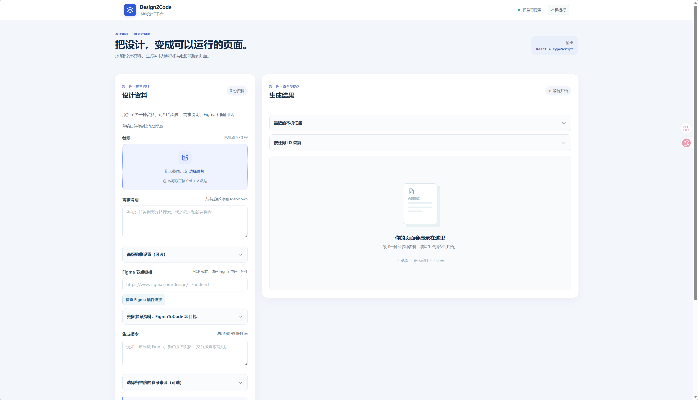
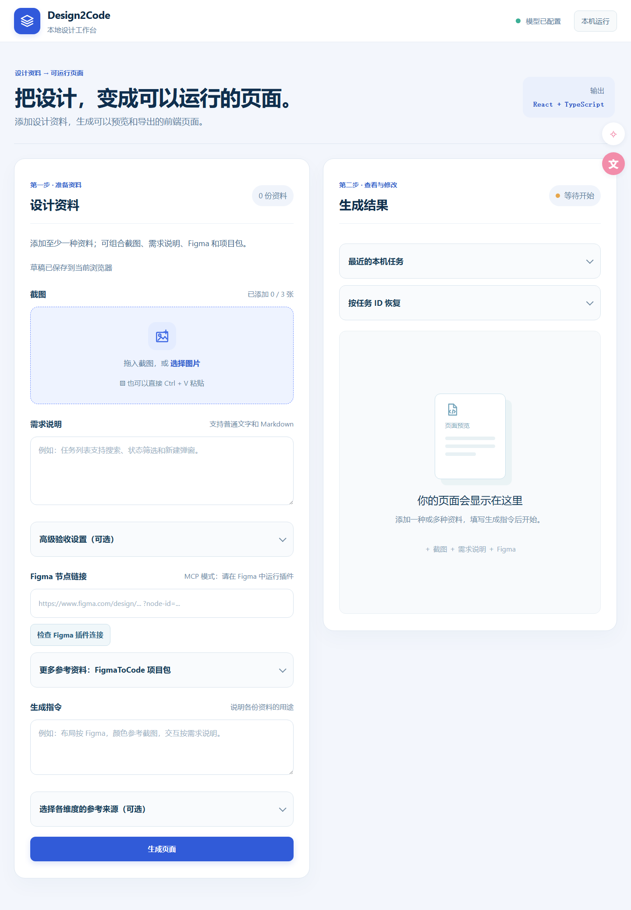

# Design2Code

## 本地启动

在项目根目录配置已有的 `.env`（不要提交），运行 `.\Start-Design2Code.ps1`；
停止运行 `.\Stop-Design2Code.ps1`。所有服务仅供本机使用。

## FigmaToCode 接入（2026-11-11）

- 项目包：导入真实插件导出的 ZIP，保存原包和源码/图片哈希，生成统一 FigmaCodeArtifact。旧 ZIP 没有转换版本时标记未知，不伪造来源。
- 直连：在 Figma Desktop 中运行本项目的 Bridge 插件，选中链接对应的一个画板。工作台默认调用 `figma_code`；保留勾选“仅读取节点/截图参考”的旧路径。
- 原插件的下载功能与 Bridge 共用 `FigmaToCode/apps/plugin/plugin-src/projectExport.ts`，沿用 `nodesToJSON`、HTML 转换、图片导出和 `generateProjectZip`；不是用普通节点 JSON 模拟转换。
- ZIP 与直连结果都进入同一 SourceSet。官方 Agent 收到实际转换源码、图片引用、Spec 和用户指令；原始 ZIP 可以独立下载，包内脚本不执行。
- 直连校验请求 ID、文件会话和选区，返回空选区、无会话、超时、转换失败、资源失败等状态，不自动重试。

构建 Bridge（先安装各目录依赖及 FigmaToCode 工作区依赖）：

```powershell
cd figma-mcp-bridge/server
npm run build
cd ../plugin
npm run build
```

在 Figma Desktop 导入 `figma-mcp-bridge/plugin/manifest.json`。插件重新启动后，若开发环境无真实 fileKey，按现有 `Bind-FigmaBridge.ps1` 流程绑定当前文件。

本次证据边界：新增契约测试通过；保存的真实单图插件包重新导入后在隔离目录实际构建并读取图片通过（不调用模型）。
Bridge 和前端可构建，FigmaToCode 原 ZIP 测试 10 项通过。当前 Bridge 无会话，实时节点转换和新三资料模型验收未执行。
Bridge 全量类型检查仍报告 99 个上游 backend 源码类型错误；Python 全量类型检查也有历史测试文件错误，不能宣称全量静态检查通过。

## 上游来源与许可

- screenshot-to-code：MIT，保留 `screenshot-to-code/LICENSE`，基线 `a8139779f7c5ae231b7f2a86fa7f83ddc5f7badc`。
- FigmaToCode：GPL-3.0，保留完整 `FigmaToCode/LICENSE`，基线 `f5c4831d5de6cffc19a73fe2823c56b4bb551281`。
- 本次新增的 Bridge 转换适配及提取出的共享导出模块按 GPL-3.0 分发；包含该转换器的插件组合构建不能仅标为 MIT。源码、构建入口和修改说明随仓库保留，原组件版权声明不删除；不提交生成的插件二进制。
- 修改范围：从 FigmaToCode 原插件入口提取共享导出函数，原下载功能继续调用同一函数；新增 Bridge 调用、后端产物契约、工作台入口与回归测试。未更改旧 platform 审批流程。

## 示例对比

以下是使用工作台截图生成 React 页面的一次真实结果。两张图的视口尺寸不同，布局、文字和间距存在差异。

<table>
  <tr>
    <th width="50%">输入截图</th>
    <th width="50%">生成页面</th>
  </tr>
  <tr>
    <td width="50%"></td>
    <td width="50%"></td>
  </tr>
</table>
